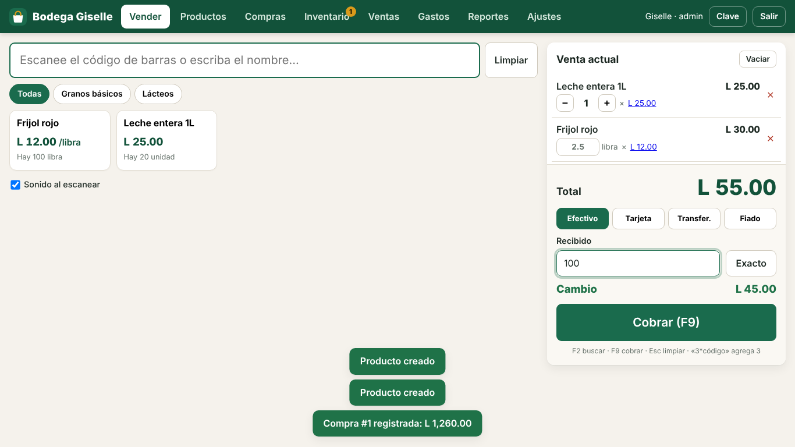
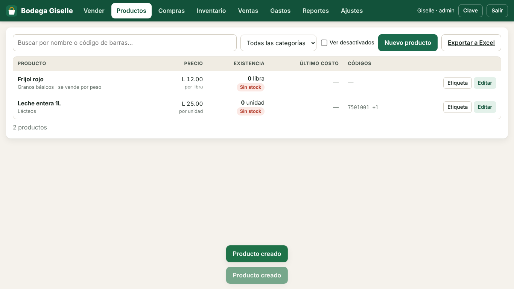
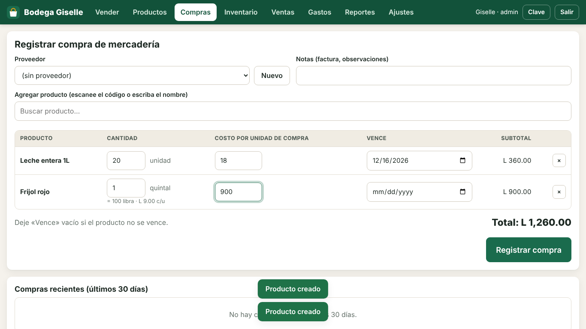
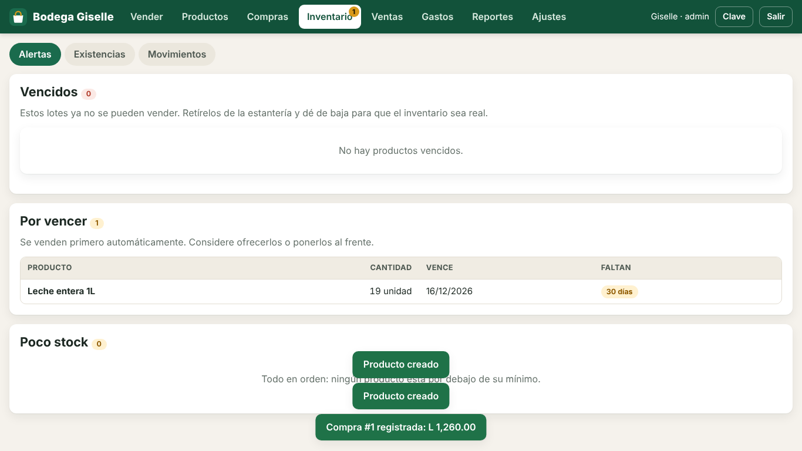
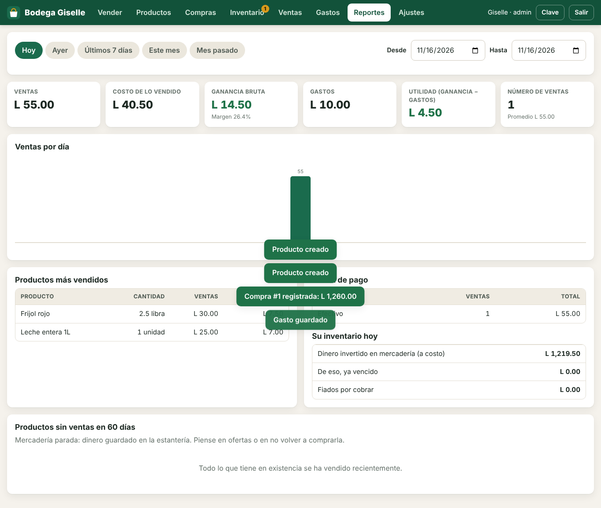

# Bodega Giselle

**Sistema de inventario, control de vencimientos y punto de venta con lector de código de barras para una abarrotería.**

Desarrollado para el negocio de mi familia, que llevaba todo "a cálculo": sin saber qué productos estaban vencidos, cuánto tenía de cada cosa ni cuánto ganaba. Funciona en Windows y Linux, sin conexión a internet y sin instalar dependencias.

> 🔗 **Demo en línea:** _(pegue aquí el enlace de la versión web de prueba)_ · los datos se guardan solo en su navegador.



## Qué hace

- **Caja (punto de venta):** escaneo con pistola USB, búsqueda por nombre, atajo `3*código`, cobro en efectivo con cambio, tarjeta, transferencia y fiado. Ticket de 80 mm.
- **Productos a granel:** el cajero escribe el peso de la balanza y el sistema calcula el precio. Conversión de unidades de compra (1 quintal = 100 libras).
- **Inventario por lotes con vencimiento:** descuenta primero lo que vence antes (FEFO); nunca vende un lote vencido. Alertas de "vencidos", "por vencer" y "poco stock".
- **Compras, mermas y ajustes** con historial completo de movimientos de inventario.
- **Contabilidad básica:** ventas, costo, ganancia bruta, gastos, utilidad, productos más vendidos, mercadería sin rotación y fiados por cobrar. Exportación a Excel (CSV).
- **Usuarios y permisos:** administrador y cajero (el cajero no ve costos ni ganancias).
- **Respaldos automáticos diarios** con restauración verificada.
- **Código de barras propio (EAN-13):** genera e imprime etiquetas para productos que no traen código.

| Productos | Compras | Inventario | Reportes |
|---|---|---|---|
|  |  |  |  |

## Decisiones técnicas

| Decisión | Por qué |
|---|---|
| **Python con solo la biblioteca estándar** | Cero instalación en la tienda; mismo código en Windows y Linux. |
| **SQLite (modo WAL, `synchronous=FULL`)** | Un solo archivo, respaldo simple, durable ante cortes de luz; suficiente para una tienda. |
| **Lotes con FEFO en vez de un número de stock** | El stock se calcula de los lotes (una sola fuente de verdad) y permite costos reales y control de vencimientos. |
| **Transacciones `BEGIN IMMEDIATE`** | Evita que dos ventas simultáneas descuenten el mismo producto dos veces. |
| **Precio y costo copiados en cada venta** | El historial no cambia cuando cambian los precios. |
| **Seguridad desde el diseño** | PBKDF2-SHA256 con sal, sesiones con token hasheado, cookie `HttpOnly` + `SameSite=Strict`, comprobación de `Origin`, CSP sin scripts en línea, bloqueo tras intentos fallidos. |
| **JavaScript sin frameworks** | Menos dependencias y se entiende todo el flujo. |

## Arquitectura

```
Navegador (HTML + CSS + JS)  ──HTTP/JSON──►  servidor.py (reglas de negocio)  ──SQL──►  SQLite
        app/static/                                app/servidor.py                    datos/bodega.db
```

## Cómo ejecutarlo

Requiere Python 3.8+.

```bash
python3 app/servidor.py --datos ./datos --puerto 8080
# abrir http://localhost:8080 y crear el usuario administrador
```

Instaladores listos para la tienda (Windows y Linux con systemd) en `empaquetado/`. Documentación en `docs/`: manual de usuario, guía de estudio, informe de base de datos.

## Pruebas

```bash
pip install requests playwright && playwright install chromium
python3 pruebas/test_api.py     # 115 verificaciones de la API contra un servidor real
python3 pruebas/test_ui.py      # 27 verificaciones de la interfaz en un navegador real
```

## Estructura del repositorio

| Carpeta | Contenido |
|---|---|
| `app/` | Servidor (`servidor.py`) e interfaz (`static/`) |
| `pruebas/` | Pruebas de API y de interfaz |
| `empaquetado/` | Scripts de instalación de Windows y Linux |
| `web-demo/` | Versión web de prueba (todo en el navegador) |
| `docs/` | Manual, guía de estudio, informe de base de datos, capturas |

## Límites conocidos y próximos pasos

- SQLite: pensado para una tienda, no para muchos usuarios escribiendo a la vez.
- No emite facturas fiscales (CAI/SAR) ni se integra con el datáfono de tarjeta.
- Los fiados se marcan como pendientes o cobrados, sin abonos parciales.
- Los scripts de Windows (`.bat`) no se han probado en una PC con Windows real.
- Pendiente: migraciones formales de base de datos, HTTPS con proxy, importación desde Excel, abonos a fiados, cierre de caja, dinero en enteros (centavos).

## Cómo se construyó

Este proyecto se desarrolló con ayuda de herramientas de IA; el diseño, el estudio del código, las pruebas y el despliegue en la tienda los hice yo. Los aprendizajes están en [`DIARIO.md`](DIARIO.md) y el caso completo en [`CASO_DE_ESTUDIO.md`](CASO_DE_ESTUDIO.md).

## Autor

**_Su nombre_** · _Estudiante de Ingeniería en Sistemas_ · [LinkedIn](#) · [correo](#)
